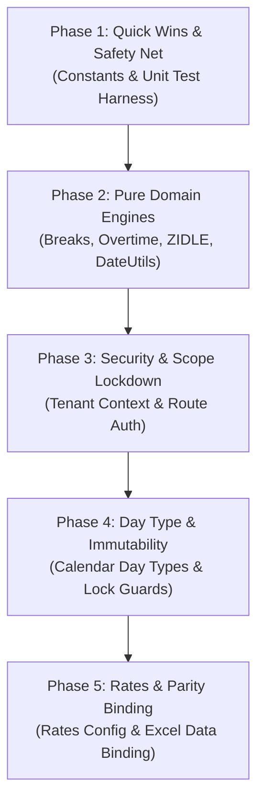

# DRY & Single Source of Truth Refactor Plan

**Project:** Mäga Construction ERP (Labour & Machinery Attendance Management System)  
**Author:** Senior Backend Engineer  
**Status:** Architecture Plan Only — Stage 2 (No Code Modifications Yet)  
**Date:** November 2026  
**Reference:** `backend/dry-audit.md`, `frontend/dev-system-spec.md`

---

## Refactor Principles & Classification Framework

Every duplicated rule or redundant implementation identified during the Stage 1 Audit is categorized into exactly one of three architectural classes:

- **CLASS A: UNIFY** — The rule can and must live in exactly one shared domain module. All call sites switch to it.
- **CLASS B: CANNOT BE A SINGLE PLACE** — The duplication is structurally necessary (e.g., client-side live preview vs. authoritative backend, SQL aggregation speed vs. in-memory row logic, database constraints as defense-in-depth, or presentation formatting). We preserve the separate copies but establish formal mechanisms (parity tests, shared configs, `MIRRORS` annotations, authoritative overrides) to prevent drift.
- **CLASS C: LEAVE ALONE** — Looks duplicated at a glance but serves a different purpose, is trivially small, or poses disproportionate migration risk with zero operational benefit.

---

# CLASS A: UNIFY (Domain Layer Consolidation)

---

### A.1. Shared Constants & Enums
- **Target Single Home:** `backend/src/domain/constants/index.ts`
- **Exports:**
  ```typescript
  export const ENTRY_STATUS = {
    DRAFT: 'draft',
    SUBMITTED: 'submitted',
    APPROVED: 'approved',
    REJECTED: 'rejected',
  } as const;
  export type EntryStatus = typeof ENTRY_STATUS[keyof typeof ENTRY_STATUS];

  export const DAY_TYPE_CODES = {
    NORMAL: 'NORMAL',
    SATURDAY: 'SATURDAY',
    SUNDAY: 'SUNDAY',
    POYA: 'POYA',
    PUBLIC_HOLIDAY: 'PUBLIC_HOLIDAY',
    SHUTDOWN: 'SHUTDOWN',
  } as const;

  export const SPECIAL_ACTIVITIES = {
    ZIDLE: 'ZIDLE',
    OT: 'OT',
    DEFAULT_GENERAL: 'GEN-01',
  } as const;

  export const ROLES = {
    SUPER_ADMIN: 'super_admin',
    ADMIN: 'admin',
    SUPERVISOR: 'supervisor',
  } as const;
  ```
- **Exact Call Sites to Switch:**
  - `backend/src/controllers/timeEntryController.ts` (lines 657, 781, 998, 1227, 1310, 1364, 1367, 1445, 1915, 2078, 2183, 2559, 2823, 3370, 3419, 3468, 3493)
  - `backend/src/controllers/calendarController.ts` (lines 8-13, 28-39, 103, 158, 188-190)
  - `backend/src/controllers/reportController.ts` (lines 77-79, 916, 991, 1027, 1433)
  - `backend/src/controllers/corporateController.ts` (lines 2184, 2221)
  - `backend/src/middleware/authMiddleware.ts` (lines 43, 64)
- **Order of Steps:**
  1. Create `backend/src/domain/constants/index.ts`.
  2. Export type definitions and enum mappings.
  3. Replace raw string literals in controllers file-by-file.
- **Tests to Write FIRST:** Unit test asserting enum values match existing database entries (`'draft'`, `'submitted'`, `'approved'`).
- **Effort:** **S** (Small, ~2 hours).
- **Risk:** **Very Low** (Pure refactor, compile-time checked by TypeScript).
- **Rollback Plan:** Revert imports and restore string literals via git checkout.

---

### A.2. Tenant Isolation & Project Resolution
- **Target Single Home:** `backend/src/domain/tenant/tenantContext.ts`
- **Function Signature:**
  ```typescript
  export function getAuthorizedProjectId(req: Request): string;
  ```
- **Exact Call Sites to Switch:**
  - Replace the 40+ copy-pasted 5-line blocks:
    - `backend/src/controllers/timeEntryController.ts` (lines 463, 642, 767, 852, 1054, 1198, 1289, 1402, 1465, 2056, 2161, 2223, 2385, 2454, 2629, 2977, 3166)
    - `backend/src/controllers/assignmentController.ts` (lines 40, 115, 187, 337, 406, 765, 907, 984, 1114)
    - `backend/src/controllers/activityCodeController.ts` (lines 16, 128, 353)
    - `backend/src/controllers/calendarController.ts` (line 171)
    - `backend/src/controllers/reportController.ts` (replace `resolveProjectId` on line 10)
    - `backend/src/controllers/supervisorController.ts` (lines 20-40, 124, 197)
- **Logic:**
  1. If `req.user` exists and `req.user.role !== 'super_admin'`, return `req.user.projectId` **authoritatively**. Do not inspect query parameters or headers.
  2. If `req.user.role === 'super_admin'`, allow query/header override (`req.query.projectId || req.headers['x-project-id']`), falling back to default project if omitted.
  3. If unauthenticated (public health check), throw an `UnauthorizedException`.
- **Order of Steps:**
  1. Implement `tenantContext.ts`.
  2. Add unit tests for regular user vs. super admin.
  3. Swap out inline resolution in each controller.
- **Tests to Write FIRST (Characterization Tests):**
  - Tenant A supervisor passes `?tenantId=tenant-B` $\rightarrow$ verifies function strictly returns `tenant-A`.
  - Super admin passes `?tenantId=tenant-B` $\rightarrow$ verifies function returns `tenant-B`.
  - Super admin omits parameter $\rightarrow$ verifies function returns default active project.
- **Effort:** **M** (Medium, ~4 hours).
- **Risk:** **Medium** (Ensures malicious clients cannot access foreign tenants, but broken frontend requests relying on query params without tokens will be rejected).
- **Rollback Plan:** Revert controller calls to previous fallback helper.

---

### A.3. Route Authentication & Ownership Guards
- **Target Single Home:** `backend/src/routes/*.ts` + `backend/src/domain/auth/ownershipGuard.ts`
- **Function Signature:**
  ```typescript
  export function assertSupervisorOwnership(req: Request, targetSupervisorId: string): void;
  ```
- **Exact Call Sites to Switch:**
  - Add `requireAuth` to all unprotected routes in:
    - `backend/src/routes/timeEntryRoutes.ts` (lines 26-35, 43-48)
    - `backend/src/routes/assignmentRoutes.ts` (lines 22-42)
    - `backend/src/routes/reportRoutes.ts` (lines 35-46)
  - Call `assertSupervisorOwnership(req, supervisorId)` in:
    - `timeEntryController.ts:634` (`checkInEmployee`)
    - `timeEntryController.ts:759` (`checkOutEmployee`)
    - `timeEntryController.ts:837` (`assignActivityBulk`)
    - `timeEntryController.ts:1050` (`upsertTimeEntry`)
    - `timeEntryController.ts:1286` (`submitDay`)
    - `timeEntryController.ts:3158` (`saveBulkLaborTimeEntries`)
- **Order of Steps:**
  1. Implement `assertSupervisorOwnership` in `ownershipGuard.ts`.
  2. Mount `requireAuth` on routers in `server.ts` or routes files.
  3. Wire ownership assertions into controller handlers.
- **Tests to Write FIRST:**
  - Test unauthenticated request to `/api/time-entries/labor/bulk` returns 401.
  - Test Supervisor A attempting to submit day for Supervisor B returns 403.
  - Test Project Admin submitting on behalf of Supervisor A succeeds.
- **Effort:** **S** (Small, ~2 hours).
- **Risk:** **Medium** (Will block external scripts or unauthenticated postman collections that previously succeeded without auth tokens).
- **Rollback Plan:** Remove `requireAuth` middleware from the router definitions.

---

### A.4. Shift Break Duration & Lunch/Dinner Deduction
- **Target Single Home:** `backend/src/domain/time/breakCalculator.ts`
- **Function Signature:**
  ```typescript
  export interface SiteMealPolicy {
    lunchBreakEnabled: boolean;
    lunchStartTime: string;
    lunchEndTime: string;
    lunchDuration: number;
    dinnerBreakEnabled: boolean;
    dinnerStartTime: string;
    dinnerEndTime: string;
    dinnerDuration: number;
  }
  export interface BreakResult {
    breakHours: number;
    isLunchDeducted: boolean;
    isDinnerDeducted: boolean;
  }
  export function calculateBreakHours(
    inTime?: string | null,
    outTime?: string | null,
    policy?: SiteMealPolicy
  ): BreakResult;
  ```
- **Exact Call Sites to Switch:**
  - `backend/src/controllers/timeEntryController.ts`: replace `computeBreakHoursAndSnapshots` (line 83) and `computeBreakHours` (line 163).
  - `backend/src/controllers/reportController.ts`: replace inline break deductions in `computeAttendanceHoursAndOt` (lines 114-124) and `getErpUploadReport` (lines 969-975).
- **Order of Steps:**
  1. Create pure function in `breakCalculator.ts` handling both daytime and overnight midnight crossovers.
  2. Write unit tests covering noon lunch, midnight dinner, normal day, and 24-hour shifts.
  3. Replace the three different implementations in `timeEntryController` and `reportController`.
- **Tests to Write FIRST (Characterization Tests):**
  - Shift `08:00 - 17:00`: lunch deducted = 1.0h, dinner = 0.0h, break = 1.0h.
  - Shift `11:30 - 14:00`: lunch deducted = 1.0h, break = 1.0h.
  - Shift `06:00 - 11:30`: no lunch overlap $\rightarrow$ break = 0.0h.
  - Midnight crossover `19:00 - 05:00`: dinner overlap (22:00-23:00) $\rightarrow$ dinner deducted = 1.0h, lunch = 0.0h, break = 1.0h.
- **Effort:** **S** (Small, ~3 hours).
- **Risk:** **Low** (Unifies report calculation with existing time entry calculation).
- **Rollback Plan:** Revert `reportController.ts` to use inline break calculation.

---

### A.5. Overtime Engine & Shift Attendance Derivation
- **Target Single Home:** `backend/src/domain/time/overtimeEngine.ts`
- **Function Signature:**
  ```typescript
  export interface ShiftCalculationInput {
    inTime?: string | null;
    outTime?: string | null;
    explicitHours?: number;
    additionalHours?: number;
    standardCap: number;
    isAllOvertime: boolean;
    isSaturday: boolean;
    isExternal: boolean;
    policy?: SiteMealPolicy;
  }
  export interface ShiftCalculationResult {
    shiftHours: number;
    otHours: number;
    breakHours: number;
    regularHours: number;
    daysWorked: number;
    isLunchDeducted: boolean;
    isDinnerDeducted: boolean;
  }
  export function calculateShiftAndOvertime(input: ShiftCalculationInput): ShiftCalculationResult;
  ```
- **Exact Call Sites to Switch:**
  - `backend/src/controllers/timeEntryController.ts`:
    - `calculateShiftAndOvertime` (line 172) $\rightarrow$ import from domain.
    - `checkOutEmployee` (line 809).
    - `assignActivityBulk` (replace lines 917-928 with single call).
    - `upsertTimeEntry` (replace lines 1117-1125 with single call).
    - `saveBulkLaborTimeEntries` (replace lines 3290-3318 with single call).
  - `backend/src/controllers/calendarController.ts`:
    - `recalculateUnapprovedEntriesForDate` (replace lines 116-129).
  - `backend/src/controllers/reportController.ts`:
    - `computeAttendanceHoursAndOt` (replace lines 105-148).
    - `getErpUploadReport` (replace lines 1037-1049).
- **Order of Steps:**
  1. Build pure domain function `calculateShiftAndOvertime` incorporating break deduction, half-day 4.0h baseline, Saturday 5.5h baseline, Sunday 100% OT, and external contractor non-negative OT.
  2. Write full test suite against all shift categories.
  3. Replace calls in `timeEntryController`, `calendarController`, and `reportController`.
- **Tests to Write FIRST:**
  - Weekday 5.0h effective $\rightarrow$ days = 0.5, OT = +1.0h.
  - Weekday 8.0h effective $\rightarrow$ days = 1.0, OT = 0.0h.
  - Weekday 10.5h effective $\rightarrow$ days = 1.0, OT = +2.5h.
  - Saturday 5.0h internal $\rightarrow$ days = 1.0, OT = -0.5h.
  - Saturday 5.0h external $\rightarrow$ days = 0.0, OT = 0.0h (no negative OT).
  - Sunday 8.0h $\rightarrow$ days = 0.0, regular = 0.0h, OT = 8.0h.
- **Effort:** **M** (Medium, ~5 hours).
- **Risk:** **Medium** (Fixes half-day overtime for bulk workflows; will change OT numbers on unapproved half-day entries).
- **Rollback Plan:** Git revert `overtimeEngine.ts` and controller integrations.

---

### A.6. Calendar Day Type & Holiday Multiplier Resolver
- **Target Single Home:** `backend/src/domain/calendar/dayTypeService.ts`
- **Function Signature:**
  ```typescript
  export interface ResolvedDayType {
    effectiveDayTypeId: string;
    code: string;
    name: string;
    rateMultiplier: number;
    standardHoursCap: number;
    isAllOvertime: boolean;
    isSaturday: boolean;
    isSunday: boolean;
  }
  export async function resolveDayTypeForDate(
    projectId: string,
    date: Date,
    explicitDayTypeId?: string
  ): Promise<ResolvedDayType>;
  ```
- **Exact Call Sites to Switch:**
  - `backend/src/controllers/calendarController.ts:52` (`getDayTypeRulesAndId`) $\rightarrow$ redirect to domain.
  - `backend/src/controllers/reportController.ts`: delete `getDayTypeRule` (lines 74-80) and replace with `resolveDayTypeForDate`.
  - `backend/src/controllers/timeEntryController.ts`: lines 860, 1062, 2231, 3174.
- **Order of Steps:**
  1. Implement `resolveDayTypeForDate` in domain layer with 60-second in-memory caching.
  2. Update `reportController.ts` to fetch day types asynchronously from this service.
- **Tests to Write FIRST:**
  - Date with configured `POYA` calendar entry $\rightarrow$ returns `standardHoursCap: 0, isAllOvertime: true, rateMultiplier: 2.0`.
  - Date with configured `PUBLIC_HOLIDAY` on a Wednesday $\rightarrow$ returns `isAllOvertime: true`.
  - Date with no calendar record on Sunday $\rightarrow$ returns default `SUNDAY` (`rateMultiplier: 1.5`).
- **Effort:** **M** (Medium, ~4 hours).
- **Risk:** **Medium** (Reports will now accurately reflect Poya/Holiday overtime instead of treating them as normal workdays).
- **Rollback Plan:** Restore synchronous `getDayTypeRule` in `reportController.ts`.

---

### A.7. Shift Immutability & Lock Guard
- **Target Single Home:** `backend/src/domain/locks/dayLockService.ts`
- **Function Signature:**
  ```typescript
  export async function assertDayNotLocked(
    projectId: string,
    date: Date,
    employeeId?: string,
    supervisorId?: string
  ): Promise<void>;
  ```
- **Exact Call Sites to Switch:**
  - Call at the entry of all mutation functions:
    - `timeEntryController.ts:652` (`checkInEmployee`)
    - `timeEntryController.ts:776` (`checkOutEmployee`)
    - `timeEntryController.ts:837` (`assignActivityBulk`) — *currently missing!*
    - `timeEntryController.ts:1050` (`upsertTimeEntry`) — *currently missing!*
    - `timeEntryController.ts:2450` (`saveOperatorEntry`) — *currently missing!*
    - `timeEntryController.ts:2621` (`saveBulkOperatorEntries`) — *currently missing!*
    - `timeEntryController.ts:2969` (`saveBulkEquipmentLogs`) — *currently missing!*
    - `timeEntryController.ts:3158` (`saveBulkLaborTimeEntries`) — *fix split deletion!*
    - `assignmentController.ts:275` (`unassignEmployee`) — *prevent deleting locked entries!*
- **Order of Steps:**
  1. Implement `assertDayNotLocked` checking both `DailySheet.isLocked` / `status in ['submitted', 'approved']` and `TimeEntry.status in ['submitted', 'approved']`.
  2. Inject at top of each controller mutation handler.
- **Tests to Write FIRST:**
  - Invoking `/api/time-entries/assign-activity` on a submitted day returns 403.
  - Invoking `/api/time-entries/labor/bulk` on an approved day returns 403.
  - Invoking on a draft day succeeds.
- **Effort:** **S** (Small, ~3 hours).
- **Risk:** **Low** (Enforces system spec rule that submitted/approved days cannot be modified).
- **Rollback Plan:** Remove the assertion calls from controllers.

---

### A.8. ZIDLE Remainder Shortage Auto-Balancing
- **Target Single Home:** `backend/src/domain/time/zidleEngine.ts`
- **Function Signature:**
  ```typescript
  export function calculateZidleShortage(
    effectiveShiftHours: number,
    allocatedSplitHours: number[],
    threshold = 0.05
  ): number;
  ```
- **Exact Call Sites to Switch:**
  - `backend/src/controllers/timeEntryController.ts:1334` (`submitDay`)
  - `backend/src/controllers/timeEntryController.ts:2098` (`approveTimeEntries`)
  - `backend/src/controllers/timeEntryController.ts:3497` (`saveBulkLaborTimeEntries`)
  - `backend/src/controllers/reportController.ts:1020` (`getErpUploadReport`)
- **Order of Steps:**
  1. Implement `calculateZidleShortage` with a unified tolerance of `0.05` hours (~3 minutes).
  2. Standardize all 4 call sites to use this function.
- **Tests to Write FIRST:**
  - Shift 8.0h, splits `[4.0, 3.0]` $\rightarrow$ returns `1.0`.
  - Shift 8.0h, splits `[4.0, 3.97]` (diff = 0.03h $\le$ 0.05h) $\rightarrow$ returns `0.0`.
  - Shift 8.0h, splits `[4.0, 3.90]` (diff = 0.10h > 0.05h) $\rightarrow$ returns `0.10`.
- **Effort:** **S** (Small, ~2 hours).
- **Risk:** **Very Low**.
- **Rollback Plan:** Git revert `zidleEngine.ts`.

---

### A.9. Effective Daily Rate & Billing Formula
- **Target Single Home:** `backend/src/domain/billing/ratesConfig.ts`
- **Function Signature:**
  ```typescript
  export const BILLING_CONFIG = {
    DAILY_RATE_DIVISOR: 8,
    OVERHEAD_PERCENTAGE: 0.10,
    STANDARD_OT_MULTIPLIER: 1.5,
    DEFAULT_LABOR_DAILY_RATE: 1400.0,
    DEFAULT_OPERATOR_DAILY_RATE: 1600.0,
  } as const;

  export function resolveEffectiveDailyRate(
    appliedDailyRate?: number | Decimal | null,
    employeeDailyRate?: number | Decimal | null,
    tradeGroupRate?: number | Decimal | null,
    isOperator?: boolean
  ): number;

  export function calculateHourlyAndOverhead(
    dailyRate: number,
    totalHours: number
  ): { hourlyRate: number; totalPayment: number; overhead: number; totalCost: number };
  ```
- **Exact Call Sites to Switch:**
  - `reportController.ts:665-670`, `755`, `1545-1548`, and `800-803`.
  - `timeEntryController.ts:896-904`, `1106-1108`, `2544`, `3244-3252`.
  - `corporateController.ts:2183`, `2211`, `3833`.
- **Order of Steps:**
  1. Create `ratesConfig.ts`.
  2. Replace rate fallback ladders and inline billing arithmetic across controllers.
- **Tests to Write FIRST:**
  - Snapshot rate 1800 present $\rightarrow$ returns 1800.
  - Snapshot rate null, employee rate 1500 $\rightarrow$ returns 1500.
  - All null for laborer $\rightarrow$ returns default 1400.
  - All null for operator $\rightarrow$ returns default 1600.
  - Calculation: daily rate 2400, 10 hours $\rightarrow$ hourly = 300, payment = 3000, OH = 300, total = 3300.
- **Effort:** **S** (Small, ~3 hours).
- **Risk:** **Low** (Consolidates magic numbers).
- **Rollback Plan:** Restore inline rate ladders.

---

### A.10. UTC Date & Filter Utilities
- **Target Single Home:** `backend/src/domain/common/dateUtils.ts`
- **Function Signature:**
  ```typescript
  export function parseDateUtc(dateStr: string): Date;
  export function buildUtcDateFilter(dateFrom?: string, dateTo?: string): { gte?: Date; lte?: Date } | undefined;
  export function getDateRangeList(from?: string, to?: string, maxDays = 366): string[];
  export function getDaysInMonthUtc(year: number, monthIndex: number): number;
  ```
- **Exact Call Sites to Switch:**
  - `assignmentController.ts:7`, `timeEntryController.ts:11`, `calendarController.ts:43` (`parseDate`).
  - `reportController.ts:45` (`buildDateFilter`) and `reportController.ts:57` (`dateRange`).
  - `reportController.ts:1410` (`daysInMonth`).
- **Order of Steps:**
  1. Create `dateUtils.ts` ensuring all operations use pure UTC dates (`Date.UTC`) without calling local `setHours()`. Remove the 31-day cap from `dateRange`.
  2. Replace date utilities across controllers.
- **Tests to Write FIRST:**
  - `parseDateUtc("2026-08-01")` produces `2026-08-01T00:00:00.000Z` regardless of machine local timezone.
  - `buildUtcDateFilter("2026-08-01", "2026-08-31")` produces `gte: 2026-08-01T00:00:00.000Z` and `lte: 2026-08-31T23:59:59.999Z`.
  - Date range for 60-day query returns all 60 days without truncating at 31.
- **Effort:** **S** (Small, ~2 hours).
- **Risk:** **Low** (Fixes timezone boundary bugs).
- **Rollback Plan:** Git revert `dateUtils.ts`.

---

### A.11. Daily Sheet Upsert Query Unification
- **Target Single Home:** `backend/src/domain/assignments/dailySheetService.ts`
- **Function Signature:**
  ```typescript
  export async function getOrCreateDailySheet(
    projectId: string,
    supervisorId: string,
    date: Date
  ): Promise<MF_OP_DailySheet>;
  ```
- **Exact Call Sites to Switch:**
  - `backend/src/controllers/assignmentController.ts:12-29`.
  - `backend/src/controllers/timeEntryController.ts:249-266`.
- **Order of Steps:**
  1. Move function to `dailySheetService.ts`.
  2. Import into both controllers.
- **Tests to Write FIRST:**
  - Concurrent calls for same `(projectId, supervisorId, date)` return identical sheet.
- **Effort:** **S** (Small, ~1 hour).
- **Risk:** **Very Low**.
- **Rollback Plan:** Restore inline function definition in controllers.

---

### A.12. Input Validation Utilities
- **Target Single Home:** `backend/src/domain/validation/entryValidation.ts`
- **Function Signature:**
  ```typescript
  export function validateHoursInput(hours: unknown, allowZero = true, maxDaily = 24.0): number;
  export function validateTimeString(timeStr?: string | null): string | null;
  export function validateDateString(dateStr: unknown): string;
  ```
- **Exact Call Sites to Switch:**
  - `timeEntryController.ts`: `assignActivityBulk`, `upsertTimeEntry`, `adminAdjustWorkerTimeEntry`, `saveBulkLaborTimeEntries`.
- **Order of Steps:**
  1. Implement validators rejecting `NaN`, negative hours, hours > 24.0, and malformed time strings.
  2. Wire into controllers.
- **Tests to Write FIRST:**
  - `validateHoursInput(25)` throws error.
  - `validateHoursInput(-2)` throws error.
  - `validateHoursInput("abc")` throws error.
  - `validateTimeString("25:99")` throws error.
- **Effort:** **S** (Small, ~2 hours).
- **Risk:** **Low** (Stops bad data at controller gateway).
- **Rollback Plan:** Remove validation calls.

---

# CLASS B: CANNOT BE A SINGLE PLACE (Keep Consistent)

The following duplications cannot physically live in one shared function. They are preserved, but kept consistent through specific mechanisms.

---

### B.1. Frontend Live Hours & Overtime Preview vs. Backend Authoritative Engine
- **Why It Cannot Be One Place:**
  The frontend (`frontend/src/utils/overtimeCalculator.ts`) calculates hours, breaks, and overtime in client memory on every keystroke (`onChange`) as the supervisor types in check-in/out times or selects activity hours. A network roundtrip to the backend on every input change would destroy mobile field usability on low-bandwidth construction sites.
- **Recommended Consistency Mechanism:**
  1. **Authoritative Backend Recompute on Save:** The backend must **never trust** frontend-calculated overtime or break hours. When the client sends `{ inTime, outTime }`, the backend's `overtimeEngine` always recomputes and overrides `shiftHours`, `breakHours`, and `overtimeHours`.
  2. **Code Comment Link:** Add `// MIRRORS: backend/src/domain/time/overtimeEngine.ts` at the top of `frontend/src/utils/overtimeCalculator.ts`.
  3. **Automated Parity Test:** A shared test fixture with 20 shift scenarios (including midnight crossover, Saturday half-day, Sunday full OT, and external subcontractors) run in the test runner against both implementations.

---

### B.2. Excel Export Formatting vs. Report JSON Data Feed
- **Why It Cannot Be One Place:**
  The JSON endpoints (`reportController.ts`) output raw semantic data for web tables, filtering, and chart cards. The Excel export (`frontend/src/features/reports/services/excelExport.ts`) generates multi-cell letterhead, frozen header panes, column widths, currency formats (`LKR #,##0.00`), borders, and colored highlight fills (`ZIDLE` red styling). Formatting cannot be unified with raw data aggregation.
- **Recommended Consistency Mechanism:**
  1. **Direct Data Binding (No Client Re-Summation):** In `excelExport.ts:841-842`, remove client-side row summation and bind directly to `data.totalHours` and `data.totalOtHours` returned by the backend JSON API.
  2. **Single Service Reuse:** `excelExport.ts` must always consume the output of `reportService.ts` (which calls `reportController.ts`), guaranteeing that screen metrics and downloaded spreadsheet values never disagree.

---

### B.3. Daily Assignment Uniqueness: DB Constraint vs. Application Service
- **Why It Cannot Be One Place:**
  Application code (`assignmentService.ts`) provides user-friendly error messages, bulk gang assignments, and automatic reassignment handling. However, application-level checks are vulnerable to race conditions under concurrent supervisor submissions. A database unique constraint is required as defense-in-depth.
- **Recommended Consistency Mechanism:**
  1. **Database Migration:** Create a database-level unique constraint or partial unique index enforcing one active assignment per worker per date across the project.
  2. **Application Handling:** Application code wraps assignments in a Prisma transaction, catching unique constraint violation code `P2002` and returning a clean 409 Conflict error.

---

### B.4. ZIDLE Storage in Database Splits vs. ERP Export Row Presentation
- **Why It Cannot Be One Place:**
  `ZIDLE` exists in the database as a child row in `MF_OP_LaborActivitySplit` so it can be audited, signed off, and stored. In the ERP Export report, IFS/SAP requires `ZIDLE` to appear as an independent top-level row item alongside regular BOQ activity lines.
- **Recommended Consistency Mechanism:**
  1. **Shared Calculation:** Both the database auto-balance function and the ERP report generator call the same pure function: `zidleEngine.calculateZidleShortage()`.
  2. **Idempotence Guard:** When generating the ERP export, the report builder checks if `activitySplits` already contains a persisted `ZIDLE` row. If present, it uses the stored record; it only injects a synthetic row if the sheet is in draft mode.

---

# CLASS C: LEAVE ALONE (Trivially Small, Different Meaning, or High Risk)

1. **Temporary Password Generator (`supervisorController.ts:generateTempPassword`):**
   *Why:* 8-line helper generating an 8-character random string for supervisor onboarding. No business logic; zero benefit in extracting to a module.
2. **Activity Code Classifier (`activityCodeHelper.ts:classifyActivityCode`):**
   *Why:* Already cleanly encapsulated in a single utility file. No duplication exists.
3. **Corporate Master vs. Site Operational Master Architecture (`MF_G_*` vs. `MF_P_*`):**
   *Why:* Re-architecting the 3-level database normalization schema documented in `database_normalization_analysis.md` requires sweeping migrations and frontend rewrites. This is an architectural database design decision, not a DRY code defect.
4. **Email Notification HTML Templates (`emailService.ts`):**
   *Why:* Inline transactional HTML templates for password reset and invite emails. Creating an external template engine adds complexity for three static email types.
5. **Report Card Metrics Layouts (`ReportFilters.tsx`, `ReportCardList.tsx`):**
   *Why:* UI presentation component code for rendering dashboard cards. Cleanly isolated to the frontend feature.

---

## Recommended Order of Work



### Phase 1: Quick Wins & Safety Net (Day 1)
1. Create `backend/src/domain/constants/index.ts` and replace raw strings across controllers.
2. Set up automated unit test framework (Jest or Vitest with TS support) in `backend/package.json`.
3. Create characterization test suite capturing current behavior for all shift types.

### Phase 2: Pure Domain Engines (Day 2)
1. Implement pure calculators: `breakCalculator.ts`, `overtimeEngine.ts`, `zidleEngine.ts`, `dateUtils.ts`.
2. Run characterization unit tests to guarantee 100% mathematical precision.
3. Wire domain engines into `timeEntryController.ts` and `reportController.ts`.

### Phase 3: Security & Scope Lockdown (Day 3)
1. Implement `tenantContext.ts` and `ownershipGuard.ts`.
2. Mount `requireAuth` on all time entry, assignment, and report routes.
3. Replace the 40+ duplicate tenant resolution blocks.

### Phase 4: Day Type & Immutability (Day 4)
1. Implement `dayTypeService.ts` and connect `reportController.ts` to the database calendar.
2. Implement `dayLockService.ts` and add `assertDayNotLocked` to all mutation endpoints.
3. Add assignment conflict detection in `assignmentController.ts`.

### Phase 5: Rates, Billing, & Parity (Day 5)
1. Clarify the Business Decision on Daily Rate Divisor (8 vs. 9).
2. Implement `ratesConfig.ts` with confirmed divisor and rate fallback ladder.
3. Clean up `excelExport.ts` in frontend to bind directly to backend precomputed totals.

---

## List of "NEEDS BUSINESS DECISION" Items

The following business rules are ambiguous or inconsistent across project documents. **Do not guess or unify these without explicit client confirmation:**

### Decision 1: Daily Rate Divisor (8 vs. 9 Hours)
- **The Ambiguity:**
  All backend code currently divides `dailyRate / 8` to determine the hourly billing rate. However, on Sri Lankan construction sites, workers are on site for 9 hours (07:30 to 17:00, including 1 hour unpaid lunch).
- **Worked Example:**
  - Worker Daily Rate: LKR 2,400.00.
  - Divisor 8: Hourly Rate = LKR 300.00 $\rightarrow$ 100 hours + 10% OH = **LKR 33,000.00**.
  - Divisor 9: Hourly Rate = LKR 266.67 $\rightarrow$ 100 hours + 10% OH = **LKR 29,333.70**.
  - Monthly Discrepancy: **LKR 3,666.30** per worker.
- **Exact Question to Ask:**
  > *"Should the Business Partner billing and internal hourly rate derivation divide the employee's Daily Rate by 8.0 (standard 8-hour workday) or by 9.0 (to account for the 1-hour unpaid lunch break on site)?"*

### Decision 2: "Days Worked" Column on Half-Days & Sundays
- **The Ambiguity:**
  In `Work Hours & Overtime (OT) Calculation Logic.md`, a weekday shift $\le$ 6.0 hours is classified as a Half Day (`daysWorked = 0.5`), and Sundays/Holidays count as zero regular days (`daysWorked = 0.0`).
  However, in `reportController:getSummaryReport` and `getDayOtSummaryReport`, the system increments `totalDays += 1` for any entry on that date.
- **Worked Example:**
  - A worker works two 4.0-hour shifts (half-days) and one Sunday shift in a week.
  - Current Report Display: **3 Days Worked**, 8.0 Normal Hours, 8.0 OT Hours.
  - Per Calculation Logic Document: **1.0 Days Worked** (0.5 + 0.5 + 0.0), 8.0 Normal Hours, 8.0 OT Hours.
- **Exact Question to Ask:**
  > *"In the Monthly Summary Report and Day & OT Matrix, should the 'Total Days' column count physical calendar days attended (1 day per check-in) or statutory payroll days (0.5 for half-days $\le$ 6h, 1.0 for full days > 6h, and 0.0 for Sundays/Holidays)?"*

### Decision 3: Subcontractor Idle Time (ZIDLE) Billing
- **The Ambiguity:**
  When a supervisor submits a day, unallocated shift hours are auto-balanced as `ZIDLE` and added to `TimeEntry.hours`.
  In `getBpBillReport`, billing is computed from `entry.hours`. This means the contractor/client is billed for idle hours when workers are not productive.
- **Worked Example:**
  - Subcontractor crew attends 8.0h shift, but supervisor only assigns 5.0h of concrete pouring; 3.0h is idle waiting for materials.
  - If ZIDLE is billed: Contractor is billed for 8.0 hours @ LKR 300/hr + 10% = **LKR 2,640.00**.
  - If ZIDLE is excluded from billing: Contractor is billed for 5.0 productive hours = **LKR 1,650.00**.
- **Exact Question to Ask:**
  > *"When external subcontractor workers have unallocated shift hours that become ZIDLE, should Business Partners be billed for the full shift attendance (including ZIDLE), or should BP Bill reports strictly bill for productive BOQ activity hours?"*

---

## Five-Line Plain-Text Summary of Refactor Plan

1. Create a pure `backend/src/domain/` layer containing single-source engines for overtime, breaks, ZIDLE, day types, and billing rates.
2. Eliminate 40+ copy-pasted tenant resolution blocks by enforcing a centralized `getAuthorizedProjectId` helper that derives scope from the verified JWT.
3. Secure all 15 unprotected time entry and assignment routes with `requireAuth` and introduce an explicit supervisor record ownership assertion.
4. Establish immutability by injecting `assertDayNotLocked` into all mutation paths, permanently stopping approved timesheets from being edited or deleted.
5. Preserve client-side live preview in Class B, but eliminate divergence through parity tests and authoritative backend recomputation on every save.
