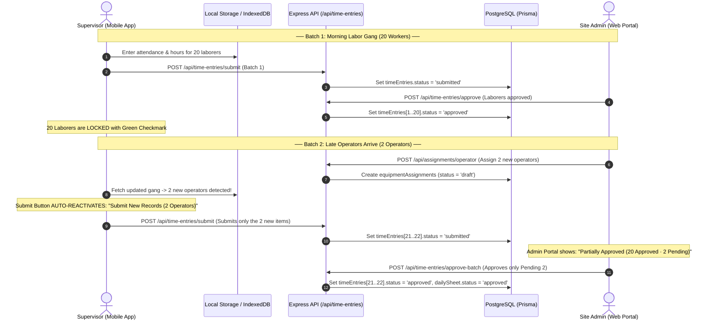

# Dynamic Batch Submission & Granular Item-Level Approval Plan
**Maga Construction ERP — Architecture & Implementation Guide**

> **Note for Development Team:**  
> This feature must be implemented on a **new isolated feature branch** (e.g., `feature/dynamic-batch-approvals`). Do not commit directly to main/testing branches until fully validated against end-to-end site scenarios.

---

## 1. Executive Summary & Problem Context

### The Challenge
In construction site operations, work allocations happen dynamically throughout the day:
1. **Morning Batch (07:00 - 08:00):** General laborers are assigned to the site supervisor. Supervisor fills attendance and hours, and submits the day. Admin reviews and approves the sheet.
2. **Afternoon / Late Batch (13:00 - 15:00):** Additional heavy machine operators or subcontractors arrive unexpectedly (e.g., emergency excavation or concrete pour). Admin assigns them to the same supervisor for the same work date.
3. **The Bottleneck:**
   - Under whole-sheet locking (`mF_OP_DailySheet.isLocked = true` / `status = 'approved'`), the Supervisor's mobile app freezes the entire day.
   - The supervisor cannot record the late operators' hours because the **Submit button is locked**.
   - Reopening the entire sheet invalidates already-approved labor entries, risking accidental edits and breaking financial audit integrity.

### The Solution: Dynamic Batch Submission & Granular Item Approvals
- **Item-Level Lock Integrity:** Once an employee/operator record is approved, that specific item is permanently locked (read-only with green verification badge).
- **Auto-Reactivating Submit Button:** The supervisor's submit button dynamically checks for unsubmitted items (`unsubmittedCount > 0`). When new operators arrive, the button unlocks automatically as:
  $$\text{Submit New Records (X Items)}$$
- **Delta Approvals on Admin Portal:** The Admin Approvals card shows partial approval states (`20 Approved · 2 Pending`) and allows approving only the late additions without reopening previously approved records.

---

## 2. Git Branch Strategy

Create a dedicated feature branch from your clean base branch before touching any code:

```bash
# 1. Fetch latest changes
git fetch origin

# 2. Ensure current workspace is clean
git status

# 3. Create and switch to new feature branch
git checkout -b feature/dynamic-batch-approvals

# 4. Verify branch
git branch --show-current
# Output should be: feature/dynamic-batch-approvals
```

---

## 3. High-Level Architecture & Data Flow



---

## 4. Detailed Implementation Phases

### Phase 1: Backend Data Model & API Extensions

#### 1.1 File: `backend/src/controllers/timeEntryController.ts`
- **Granular Approval Endpoint:**
  - Create or extend `approveTimeEntries` to support an optional array of `employeeIds` / `assignmentIds`:
    ```typescript
    // POST /api/time-entries/approve-items
    export const approveSpecificItems = async (req: Request, res: Response) => {
      const { dailySheetId, employeeIds, equipmentAssignmentIds } = req.body;
      // 1. Update only specified timeEntries to 'approved'
      // 2. Update only specified equipmentDailyLogs to 'approved'
      // 3. Check if all items in dailySheet are now approved -> if yes, mark dailySheet 'approved', else 'partially_approved'
    };
    ```
- **Update `getApprovalOverview` Response:**
  - In each supervisor group data, return granular counts:
    ```typescript
    counts: {
      laborTotal: number,
      laborApproved: number,
      laborPending: number,
      operatorsTotal: number,
      operatorsApproved: number,
      operatorsPending: number,
    },
    sheetState: 'not_submitted' | 'submitted' | 'partially_approved' | 'approved'
    ```

#### 1.2 File: `backend/src/controllers/assignmentController.ts`
- In `assignOperators` and `assignEmployees`:
  - When new assignments are created for a date where a `mF_OP_DailySheet` already exists:
    - Keep `dailySheet.id`.
    - If `dailySheet.status === 'approved'`, change `dailySheet.status = 'partially_approved'` (or keep `status = 'draft'` for the new rows while leaving `dailySheet.isLocked = false` for incremental submission).

---

### Phase 2: Supervisor Mobile App UI & State Logic

#### 2.1 File: `frontend/src/features/supervisor/services/supervisorStorageService.ts`
- **Track Status Per Employee / Operator:**
  - Add `approvalStatus?: 'draft' | 'submitted' | 'approved'` to `LaborerEntry` and `OperatorEntry`.
- **Incremental Submission Payload:**
  - Update `submitDayToBackend` to send only records where `approvalStatus !== 'approved'`.

#### 2.2 File: `frontend/src/features/supervisor/views/DailySummaryView.tsx`
- **Dynamic Submit Button Reactivation:**
  ```typescript
  // Calculate unsubmitted items count
  const unsubmittedLaborers = (laborers || []).filter(l => l.approvalStatus !== 'approved');
  const unsubmittedOperators = (operators || []).filter(o => o.approvalStatus !== 'approved');
  const totalUnsubmitted = unsubmittedLaborers.length + unsubmittedOperators.length;

  const isCompletelyApproved = totalLaborers > 0 && totalOperators > 0 && totalUnsubmitted === 0;
  const isIncrementalBatch = (totalLaborers + totalOperators) > totalUnsubmitted && totalUnsubmitted > 0;
  ```
- **Render Button Dynamically:**
  ```tsx
  {totalUnsubmitted > 0 ? (
    <button
      type="button"
      onClick={() => setShowConfirmModal(true)}
      className="w-full flex items-center justify-center gap-2 py-3.5 px-4 rounded-xl bg-blue-700 hover:bg-blue-800 text-white font-bold text-sm shadow-md"
    >
      <Send size={16} />
      <span>
        {isIncrementalBatch 
          ? `Submit Supplementary Records (${totalUnsubmitted} Items)` 
          : 'Submit & Lock Day Roster'}
      </span>
    </button>
  ) : (
    <div className="p-3 bg-emerald-50 border border-emerald-200 text-emerald-800 rounded-xl text-center text-xs font-semibold flex items-center justify-center gap-2">
      <CheckCircle2 size={16} className="text-emerald-600" />
      <span>All shift entries for today are verified & locked</span>
    </div>
  )}
  ```

#### 2.3 Visual Locking in Attendance & Equipment Views
- In `DailyAttendanceView.tsx` and `EquipmentLogsView.tsx`:
  - Check `item.approvalStatus === 'approved'`.
  - If approved: Display read-only badge: `✓ Verified by Management`. Disable input fields.
  - If unapproved: Input fields remain active for the supervisor to fill.

---

### Phase 3: Admin Approvals Portal Enhancements

#### 3.1 File: `frontend/src/features/approvals/components/SupervisorApprovalCard.tsx`
- **Tab Indicators:**
  - Show status badges:
    - `All Approved` (Green)
    - `Partially Approved (X Approved, Y Pending)` (Amber)
    - `Pending Review` (Blue)
- **Action Buttons:**
  - If `group.counts.pendingCount > 0`:
    - Show button: **`Approve Pending (${pendingCount})`**
  - Next to each individual row (Laborer or Operator):
    - If status === 'approved': Green badge `✓ Approved`.
    - If status === 'submitted': Blue badge `Pending` + inline check button.

---

## 5. Verification & Test Scenarios

Execute the following test cases in sequence after completing the code implementation:

| Test ID | Scenario | Expected Outcome | Pass/Fail |
| :--- | :--- | :--- | :--- |
| **TC-01** | Assign 10 Laborers in the morning; Supervisor enters times & submits. | Sheet is marked `Submitted`. Admin Approvals card displays 10 Pending. | [ ] |
| **TC-02** | Admin clicks "Approve All". | All 10 Laborers marked `Approved`. Card moves to Approved tab. | [ ] |
| **TC-03** | At 14:00, Admin assigns 2 Machine Operators to the same supervisor for the same date. | 2 Operators appear in Supervisor Mobile App. 10 Laborers remain locked (green). Submit button unlocks as "Submit Supplementary Records (2 Items)". | [ ] |
| **TC-04** | Supervisor inputs In/Out times for the 2 Operators and clicks Submit. | Only the 2 Operators are sent to server. The 10 already-approved laborers are not re-sent or disturbed. | [ ] |
| **TC-05** | Admin opens Approvals page. | Card shows `Partially Approved: 10 Approved · 2 Pending`. | [ ] |
| **TC-06** | Admin clicks "Approve Pending (2)". | 2 Operators change to `Approved`. Sheet transitions to full `Approved` status. | [ ] |

---

## 6. Implementation Checklist & Next Steps

When ready to implement, follow this checklist step-by-step:

- [ ] **Step 1:** Create branch `git checkout -b feature/dynamic-batch-approvals`
- [ ] **Step 2:** Update Prisma models / verify `status` column on `MF_L_TIME_ENTRY` and `MF_L_EQUIPMENT_DAILY_LOG`
- [ ] **Step 3:** Implement granular approval endpoint in `backend/src/controllers/timeEntryController.ts`
- [ ] **Step 4:** Implement dynamic lock & supplementary submit in `frontend/src/features/supervisor/views/DailySummaryView.tsx`
- [ ] **Step 5:** Add row-level approval indicators in `frontend/src/features/approvals/components/SupervisorApprovalCard.tsx`
- [ ] **Step 6:** Run test suite & manual site simulation (TC-01 to TC-06)
- [ ] **Step 7:** Create Pull Request into `DB_V2_test` or `main`
