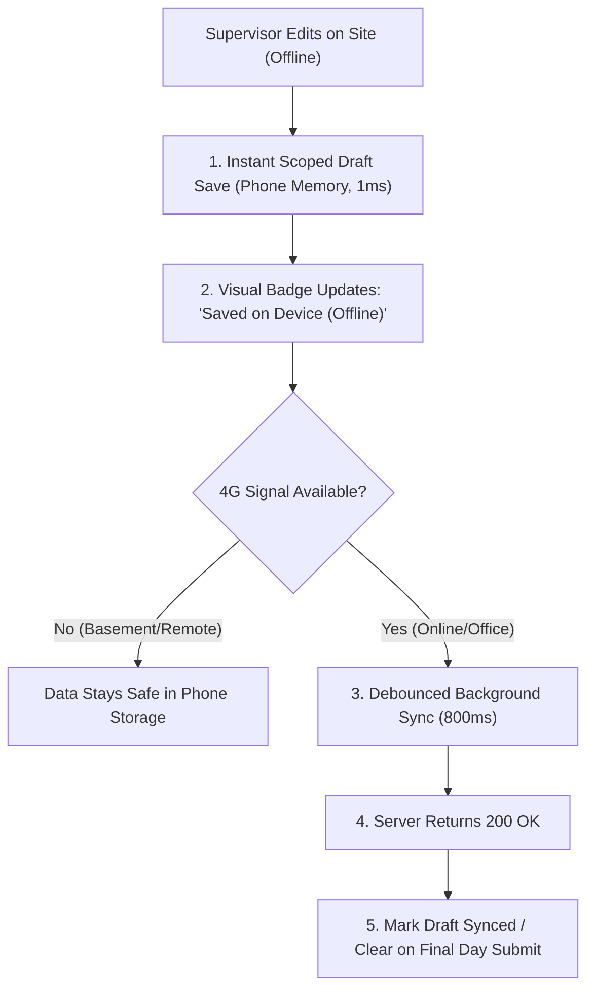
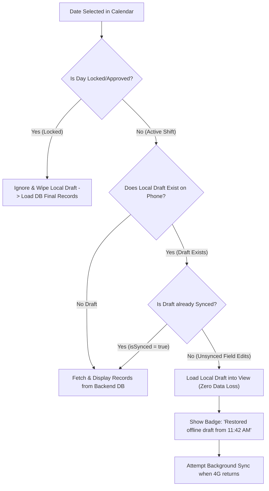

# Architecture Plan: Conflict-Free Offline Field Drafts for Site Supervisors

**Target Views:** 
1. `LaborEntryView.tsx` (Laborers, Attendance, Work Allocations)
2. `OperatorEntryView.tsx` (Machine Operators, Operating Hours, Allocations)
3. `EquipmentLogsView.tsx` (Heavy Equipment, Machine Logs, Meter Readings)

**Parent Orchestrator:** `SupervisorMobileApp.tsx`  
**Target Environment:** Mobile APK via Capacitor & Mobile Web (Android / Chrome WebView)  
**Goal:** Enable real-time field data entry on slabs and basements without 4G connectivity, with zero data loss, and **zero data conflicts / merge chaos**.

---

## 1. Root Cause of Previous Failure & The 5 Immutable Rules

### Why the Previous `localStorage` Implementation Failed
In the earlier attempt, `localStorage` acted like an uncontrolled second database. When keys were generic (e.g., `saved_laborers`), old drafts from yesterday overwrote today’s attendance, site-to-site data collided, and reconnecting to the internet caused race conditions between the server and the browser.

### The 5 Immutable Rules of this Architecture



1. **Rule 1: Scoped & Namespaced Keys**  
   Every single draft key is strictly tied to 4 variables: **Version + Module + Site + Supervisor + Date**.  
   *A draft for Site A on Nov 6 can physically NEVER touch or corrupt Site B or Nov 7.*
2. **Rule 2: Instant Dual-Layer Save**  
   When a supervisor enters data, it writes synchronously to the phone's local storage in **1 millisecond**. Then, in the background, a debounced sync attempts to hit the backend API (800ms). If 4G drops, the phone copy is already secured.
3. **Rule 3: Deterministic Conflict Resolution (The "Field Priority" Rule)**  
   * **If Day is Locked/Approved (`isLocked = true`):** The server is final. Local drafts are discarded.
   * **If Day is Active & Unsubmitted:** The supervisor's live field edits on this device take priority over stale database state.
4. **Rule 4: Atomic Purge on Final Submit**  
   When the supervisor arrives at the site office and clicks **"Submit Day" / "Lock Day"**, upon server confirmation (`200 OK`), the local drafts for that day are immediately deleted. No ghost data can resurrect tomorrow.
5. **Rule 5: Automatic Garbage Collection**  
   A background cleanup utility automatically purges drafts older than 5 days to ensure phone memory remains fast and uncluttered.

---

## 2. Storage Key Schema

Drafts are stored using standard JSON serialization with metadata:

| Module | Local Storage Key Pattern | Example Key |
| :--- | :--- | :--- |
| **Labor Entry** | `MAGA_FIELD_DRAFT:v1:labor:<siteId>:<supervisorId>:<YYYY-MM-DD>` | `MAGA_FIELD_DRAFT:v1:labor:PRJ01:user_123:2026-11-06` |
| **Operator Entry** | `MAGA_FIELD_DRAFT:v1:operator:<siteId>:<supervisorId>:<YYYY-MM-DD>` | `MAGA_FIELD_DRAFT:v1:operator:PRJ01:user_123:2026-11-06` |
| **Equipment Logs**| `MAGA_FIELD_DRAFT:v1:equipment:<siteId>:<supervisorId>:<YYYY-MM-DD>`| `MAGA_FIELD_DRAFT:v1:equipment:PRJ01:user_123:2026-11-06` |

### Stored Payload Structure
```typescript
interface FieldDraftEnvelope<T> {
  version: 1;
  module: 'labor' | 'operator' | 'equipment';
  siteId: string;
  supervisorId: string;
  date: string;          // ISO Date 'YYYY-MM-DD'
  updatedAt: number;     // Unix timestamp (Date.now())
  isSynced: boolean;     // True if latest changes reached backend
  data: T;               // LaborerEntry[] | OperatorEntry[] | EquipmentLogEntry[]
}
```

---

## 3. Visual UI Feedback (Supervisor Peace of Mind)

Supervisors need to know their work is safe without having to guess. In `SupervisorTopBar.tsx` or `SupervisorSubHeader.tsx`, we add a live Sync Status Indicator:

* 🟢 **Synced:** All records stored safely on company cloud servers.
* 🟡 **Saved on Phone (Offline):** 4G signal is unavailable, but entries are 100% saved on the phone.
* 🔵 **Syncing...:** Background upload in progress.
* 🔴 **Sync Error (Tap to Retry):** Explicit error with a 1-tap manual retry button.

---

## 4. File-by-File Changes Matrix

Because our architecture centralizes state inside `SupervisorMobileApp.tsx`, **we do not need to butcher the 1000+ line child components (`LaborEntryView`, `OperatorEntryView`, `EquipmentLogsView`)**. They already emit `onSaveLaborers(updated)`, `onSaveOperators(updated)`, and `onSaveEquipment(updated)`.

| File Path | Action | Description of Changes |
| :--- | :--- | :--- |
| `frontend/src/features/supervisor/services/fieldDraftService.ts` | **NEW FILE** | Dedicated standalone service with pure functions: `saveDraft()`, `loadDraft()`, `clearDraft()`, `hasUnsyncedDraft()`, `cleanupStaleDrafts()`. No side effects. |
| `frontend/src/features/supervisor/SupervisorMobileApp.tsx` | **MODIFY** | • Wrap `handleSaveLaborers`, `handleSaveOperators`, `handleSaveEquipment` with instant local draft saving.<br>• On `selectedDate` change, safely hydrate from local draft if offline or if local draft is newer than DB records.<br>• On `handleLockDay` / `submitDay`, clear local drafts upon success.<br>• Call `cleanupStaleDrafts()` on app mount. |
| `frontend/src/features/supervisor/components/SupervisorSubHeader.tsx` | **MODIFY** | Add visual Sync Status Pill (🟢 Synced / 🟡 Saved Locally / 🔵 Syncing) with tap-to-retry capability. |
| `frontend/src/features/supervisor/views/LaborEntryView.tsx` | **VERIFY / MINOR** | Verify that state changes trigger `onSaveLaborers`. Add "Unsaved Offline" mini-indicator on table footer. |
| `frontend/src/features/supervisor/views/OperatorEntryView.tsx` | **VERIFY / MINOR** | Verify `onSaveOperators` and `onSaveEquipment` pass clean state. |
| `frontend/src/features/supervisor/views/EquipmentLogsView.tsx` | **VERIFY / MINOR** | Verify `onSaveEquipment` captures meter readings, breakdowns, and hour updates into the draft. |

---

## 5. Conflict Resolution Workflow (Exact Logic)

When a supervisor opens a date or switches dates:



---

## 6. Verification & Safety Checklist Before Execution

Before writing code, we guarantee:
- [x] **No cross-date pollution:** Changing the calendar date always isolates storage to that specific date string.
- [x] **No cross-site pollution:** Switching project sites uses the active project's ID in the key.
- [x] **No storage overflow:** Auto-cleanup purges keys older than 5 days.
- [x] **Clean exit on Final Submission:** Wiping keys after final submit ensures yesterday's data never leaks into today.
